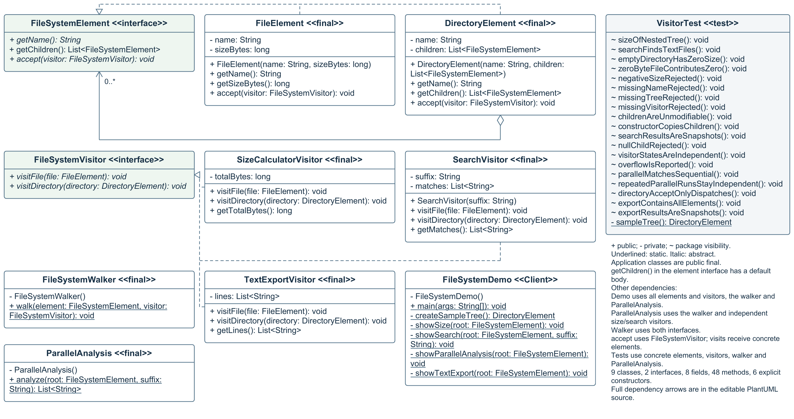

# File System Visitor

Assignment 6 Software Design Patterns Java 17

## 1 Introduction

The in-memory model contains FileElement and DirectoryElement. SizeCalculatorVisitor totals file bytes, SearchVisitor finds .txt files, and TextExportVisitor adds a listing operation without changing the elements. FileSystemWalker traverses the same tree. Double dispatch selects the concrete element's accept, then the concrete visitor's visitFile or visitDirectory implementation. No element-type checking chain is used.

## 2 UML class diagram



All application and test classes, fields, methods and explicit constructors are shown.

## 3 Clean Code

### Runs all the tests

Chapter 12. Repeatable unit checks cover both element types, visitor results, copies and independent tasks. All 19 tests passed.

```java
// Size visitor in a repeatable unit test.
FileSystemWalker.walk(sampleTree(), visitor);
assertEquals(13000, visitor.getTotalBytes());
```

### No duplication

Chapter 12. One walker owns the traversal. Every visitor reuses it, so adding an operation does not duplicate recursive tree walking.

```java
element.accept(visitor);
for (FileSystemElement child : element.getChildren()) {
    walk(child, visitor);
}
```

### Expressive code

Chapter 12. Names state each operation's purpose. Small client methods separate size calculation, searching, export and parallel analysis.

```java
SizeCalculatorVisitor visitor = new SizeCalculatorVisitor();
FileSystemWalker.walk(root, visitor);
System.out.println("Total size: " + visitor.getTotalBytes() + " bytes");
```

### Use copies of data

Chapter 13. DirectoryElement snapshots the input list; SearchVisitor returns a read-only snapshot. Callers cannot mutate internal collections.

```java
this.children = List.copyOf(children); // DirectoryElement
return List.copyOf(matches);           // SearchVisitor
```

### Keep threads independent

Chapter 13. Two tasks share the immutable sample tree. Each creates its own mutable visitor; Future.get retrieves completed results.

```java
Future<Long> size = executor.submit(() -> {
    SizeCalculatorVisitor visitor = new SizeCalculatorVisitor();
    FileSystemWalker.walk(root, visitor);
    return visitor.getTotalBytes();
});
```

## 4 Sample output

Selected lines from one run on the same tree.

```text
1. SIZE CALCULATOR VISITOR
Root: coursework
Total size: 13000 bytes

2. SEARCH VISITOR
Match: notes.txt
Match: todo.txt
Matches found: 2
```

## 5 Conclusion

Visitors read names, sizes and children through public getters, so operations depend on these exposed details. Fields remain private; the concrete elements and child lists are immutable. A new operation leaves elements unchanged. A new element type requires updating the visitor interface and every visitor.

## Repository

https://github.com/ramazanutegen583-pixel/visitor-pattern-file-system

Reference: Robert C. Martin, Clean Code (2008), Chapters 12 Emergence and 13 Concurrency.
